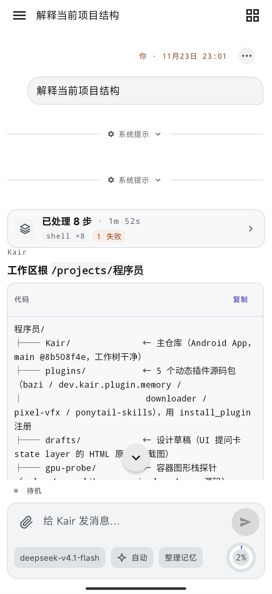
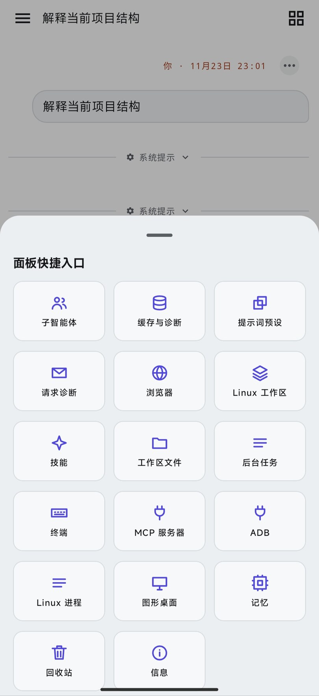
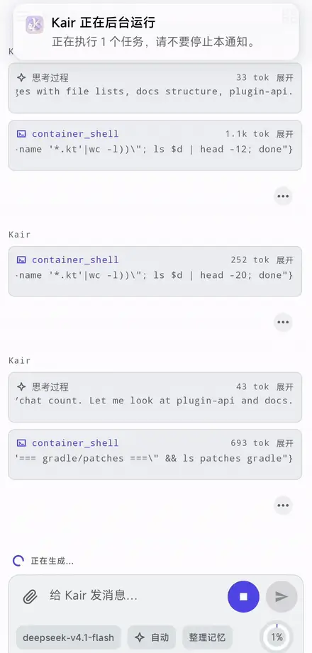
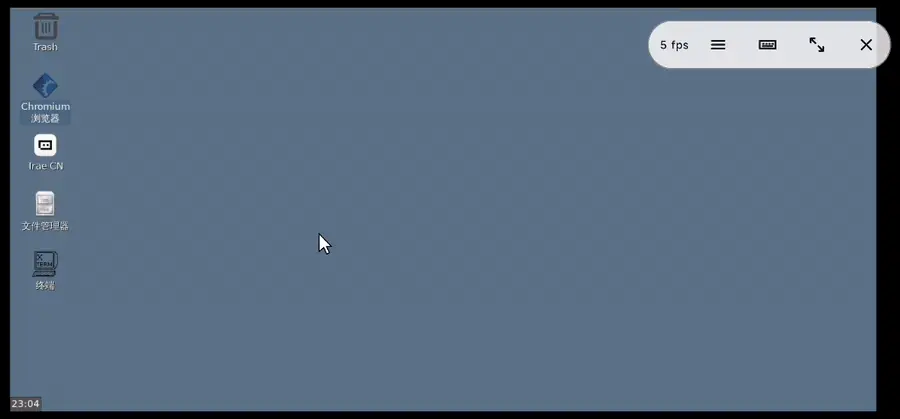
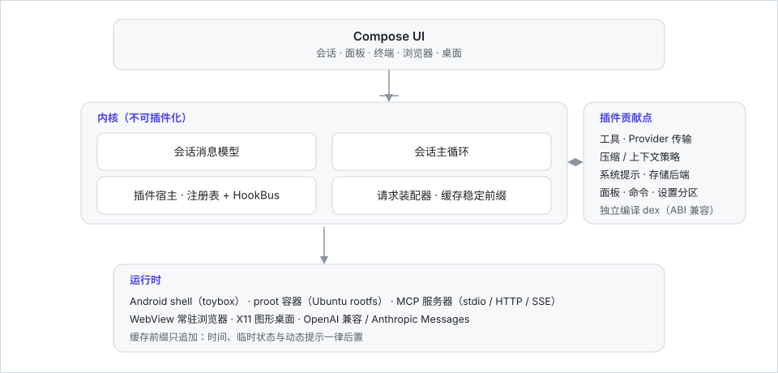

<p align="center">
  
</p>

<h1 align="center">Kair</h1>

<p align="center">运行在 Android 上的编码 Agent —— 内核极简，能力皆可插拔</p>

<p align="center">
  <a href="LICENSE"></a>
  <a href="https://github.com/76am/Kair-Android-agent/actions/workflows/ci.yml"></a>
  
  
</p>

Kair 把一个完整的编码 Agent 放进手机：纯 Kotlin 内核 + Jetpack Compose 界面，
Linux 工作区、工具调用、审批闸门、插件、MCP、子智能体与浏览器都在同一个会话里。

> 参考过 `pi` / `pi-web` 的部分思路，但不是移植分支，也不追求与其契约对齐。

## 界面

<p align="center">
  
  
</p>

<p align="center"><sub>工具执行按实际耗时折叠，目录与命令结果留在会话里；
面板快捷入口把技能、浏览器、Linux 工作区、MCP、子智能体等能力集中在一处。</sub></p>

## 演示

<p align="center">
  
</p>

<p align="center"><sub>Agent 连续调用工具：先看结构，再跑命令，进度与 token 用量实时回显。</sub></p>

<p align="center">
  
</p>

<p align="center"><sub>容器内的 X11 桌面：从面板启动，Chromium 直接打开网页。</sub></p>

## 特性

- **会话式编码 Agent**：工具调用、审批闸门、提问卡、回合终止、上下文压缩、缓存命中统计。
- **多 Provider**：OpenAI 兼容端点（OpenAI / OpenRouter / DeepSeek / Groq / xAI / Gemini / Ollama /
  自定义）与 Anthropic Messages。
- **Linux 工作区**：proot + Ubuntu rootfs（运行时下载），容器内可用 apt / git / Python / Node；
  工作区父目录挂到 `/projects`，内置 PTY 终端与图形桌面（X11 / Xvfb）。
- **能力皆可插件**：工具、面板、命令、设置分区、存储后端、Provider 传输层、上下文策略、系统提示贡献
  都是贡献点；支持数据 + 脚本式动态插件，契约按 ABI 兼容（旧插件不会因宿主升级而崩）。
- **MCP**：stdio / HTTP / SSE 服务器，工具统一以 `mcp__<server>__<tool>` 命名。
- **子智能体**：`coding` / `search` / `browser` 三类，浏览器子智能体由独立 WebView 驱动。
- **内置浏览、记忆、定时任务、回收站、工作区文件**等面板，全部可单独禁用。

## 架构

内核只有四块不可插件化：会话消息模型、会话主循环、插件宿主（注册表 + HookBus）、请求装配器与
「缓存稳定前缀」契约。其余一律通过插件贡献点接入。

<p align="center">
  
</p>

两条产品原则贯穿全部取舍：

1. **能力皆可插拔** —— 新能力优先做成插件，而不是往内核加分支。
2. **高缓存命中率** —— 进入 prompt 前缀的内容必须确定性、只追加、易变内容后置。

详见 [`docs/架构与内核边界.md`](docs/架构与内核边界.md)。

## 快速开始

环境要求：

- JDK 17
- Android SDK：`compileSdk = 35`、`build-tools 35.0.0`
- Gradle wrapper（仓库自带，8.14.5）

```bash
./gradlew :app:assembleDebug :plugin-api:test :app:testDebugUnitTest ktlintCheck
```

内存有限的机器：

```bash
./gradlew :app:assembleDebug :plugin-api:test :app:testDebugUnitTest ktlintCheck --no-parallel \
  -Dorg.gradle.jvmargs="-Xmx1400m -XX:MaxMetaspaceSize=512m -Dfile.encoding=UTF-8"
```

产物：`app/build/outputs/apk/debug/app-debug.apk`。

### 安装

1. 自行构建，或从 Releases 下载 APK。
2. 首次安装允许「安装未知应用」。
3. 首次启动后到「Linux 工作区」面板安装 rootfs，再配置模型即可对话。

权限（以 `app/src/main/AndroidManifest.xml` 为准）：网络、前台服务、通知、电池优化豁免、
共享存储读写（供 `/sdcard` 挂载）。`usesCleartextTraffic=true` 用于连接本机 Ollama 等明文端点。

### 签名

debug 签名固定在仓库内 `keystore/kair.jks`（别名 `androiddebugkey`，口令均为 `android`），
目的是让不同机器构建出的 APK 可以直接覆盖安装。

该 keystore 是标准 debug 密钥，**只用于调试分发，不要用于上架**。正式发布请换成自己的 release 签名；
换签名后手机上需要先卸载旧包。

## 文档

| 文档 | 内容 |
|---|---|
| [`AGENTS.md`](AGENTS.md) | 工程硬约束：产品原则、内核边界、缓存安全、语言规则、插件 ABI |
| [`docs/架构与内核边界.md`](docs/架构与内核边界.md) | 目标架构、内核四件套、插件能力目录、缓存契约与实现状态 |
| [`docs/插件接口契约.md`](docs/插件接口契约.md) | 插件 API 契约（贡献点、钩子、生命周期、动态插件） |
| [`docs/代码索引.md`](docs/代码索引.md) | 复用索引与改动落点 |
| [`docs/代码规范.md`](docs/代码规范.md) | 包结构、命名、协程、测试与提交规范 |
| [`docs/界面规范.md`](docs/界面规范.md) | 界面文件组织、复用优先、外壳 / 面板 / 对话框 |

## 第三方与许可证

本项目以 [Apache License 2.0](LICENSE) 发布。

APK 内含以独立进程方式调用的 proot（GPL-2.0）与静态链入其中的 talloc（LGPL-3.0）。
对应的上游版本、补丁与构建脚本在本仓库 `scripts/`、`patches/` 中，见 [NOTICE](NOTICE)。
Ubuntu rootfs 由应用在运行时从公开镜像下载，不在本仓库内分发。

## 贡献

见 [CONTRIBUTING.md](CONTRIBUTING.md)。提交前请确保
`./gradlew :app:testDebugUnitTest :plugin-api:test ktlintCheck` 通过。

## 已知限制

- 项目仍处于早期阶段：插件契约与内部结构可能变化，变化会走 `KairApi.VERSION`。
- `targetSdk = 28`：为了 proot 的 exec / 挂载语义，暂未跟上 Android 新版本的存储与权限模型。
- debug 签名、中文界面。
- 部分能力（proot、悬浮窗、无障碍）依赖设备与系统版本，异常时会在面板内给出可读提示。
